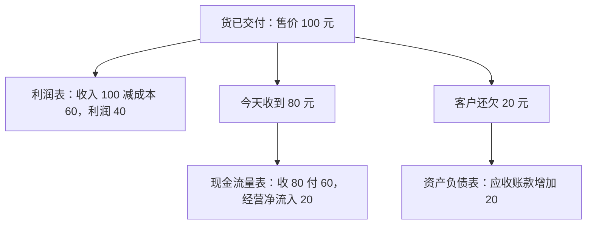

# 小白的股票投资启蒙课

**课程计划｜12 个单元，66 节。** 用不需要金融学历的语言，讨论有多年投资经验的人仍会遇到的判断。会算百分数就能跟上；已经会算的人，应能带走一个原先没问过的问题。目标不是猜中下一根 K 线，而是拿着财报、产品说明书、交易记录和一条新闻，独立说明：买的是什么、这个价格隐含什么、什么会推翻判断、判断错了要付多少钱。不需要开户或拿真钱练习。

## 怎么读，也怎么写

- **核心内容不限篇幅：**用初中生也能懂的语言，给做过多年投资的人讲。核心问题需要几千字，就写几千字；通勤是方便分段停读，不是每节的时长上限。篇幅用在关键推导、资料原文和会改变结论的反例上。比如讲增发，不能停在「股数增加会稀释」：用同一家公司的账，分别算按合理价和低价增发后，老股东的持股比例与每股价值怎样变化。简单概念说清即止，不设最低字数。
- **把推理摊开：**给读者当时能取得的材料，区分披露、假设和未知。用一笔能复算的账或一段可定位的原文支撑结论，再改变一个关键条件，说明为什么行动应变或不变。数字注明时点、分母、现金流和省略项；结论写到证据用尽为止。
- **图也要回答问题：**路径与资金流画出来，金额对账用表。每课至少一幅真正解释机制的图，紧贴对应段落；图注告诉读者看哪里，轴、单位、假设写清，手机上不用放大才能读。不给一段常识硬配装饰图。
- **下班三分钟：**先选行动，留下依据，再展开答案。题目换一个条件，不让人只复述定义。回到自己的旧交易，找出一条当时就能用、而不是事后才显得聪明的判断。开车或骑车时不看图、不做题。
- **不赶进度：**每周读 5 节，约 14 周走完；漏读不必补两节。先做第 1 单元的防冲动练习，再顺序读。财报和量化课可以一节用两趟通勤。
- **贯穿全课的材料：**一本模拟账户账本、一家调味品公司的真实年报、一份宽基 ETF 资料、一页自己的决策记录。历史案例只给当时已公开的信息；先选“行动、等待还是放弃”，再揭晓结果。

## 第一单元｜先学会暂停，再学怎么买（01–05）

01. **一跌就想加钱翻本，先看什么？** 把决定停在公告当日：股价低了，未来能赚的钱是否也变了？分清事实、推断和想翻本的心情；按同一笔本金比较加仓和保留现金，再用两种后续结果复盘，不用输赢倒推决策质量。
02. **跌了 20%，为什么涨 20% 还没回来？** 从 100→80 的账走到一条有中途高点的净值路径，区分持有收益、当前回撤与最大回撤；用追加本金制造一次假回本，看余额为何不能替策略打分。
03. **一只股票跌三成，我的钱会少多少？** 以同样的 1 万元自有资金对照小仓位、全仓、借钱买。画清资产和债务，推演损失怎样传给净资产；从生活用款与情景损失倒推仓位，指出何时会被迫提前卖出。
04. **为什么买入价总让人惦记？** 同一现价、两种持仓成本，遮住成本后再比较持有、卖出与替代去向。用现金需求或交易摩擦做反例：成本不是估值依据，不等于每个人都该做同一笔交易。
05. **我的第一张下单前检查卡。** 用一则模拟披露写完整的决策记录：什么已证实，价格隐含什么，哪里会错，仓位能否承受，何时再看。先展示为什么等待，再给一条新证据，请读者只更新被它改变的字段。

## 第二单元｜股票的来历：我究竟买了什么（06–10）

06. **合伙开面馆，我出了两成钱，拥有什么？** 画出顾客付款、偿债、维持经营和股东分配的关系。店赚了钱但需要换炉子，为什么两成股权不代表今天就能拿走两成利润？对照借钱给店主的人，指出谁先承受亏损。
07. **从远洋船队到阿姆斯特丹。** 出资人中途要用钱，船还在海上：抽回船上的本钱和把股份卖给另一个人，对这门生意有何不同？用有来源的时间线讲制度怎样解决期限不匹配，不拿后来的交易规则套早期市场。
08. **公司上市，钱进了谁的口袋？** 同价分别发行新股和转让老股，画出两笔钱的去向，重算老股东所占比例；区分比例被稀释和每股经济价值受损，两者不一定一起发生。
09. **纳斯达克为什么从“报价”讲起？** 从 1971 年启用的电子报价系统区分「看得见报价」与「已成交」。拿同一家大公司在纳斯达克综合指数和纳斯达克 100 的权重作对照，解释为什么不能用一个指数的涨跌代表整座交易所。
10. **A 股怎样发展起来的？** 从股份制试点、沪深交易所起步讲到北交所。拿「在某交易所上市，所以一定属于某指数」这句话，对照一家公司所在板块和一份有日期的指数编制方案，找出推理断在哪一步。

## 第三单元｜一次下单，到底花了多少钱（11–16）

11. **屏幕显示 10 元，我为什么不能按 10 元买？** 读懂最新成交价、买方最高报价、卖方最低报价；第一次看懂买卖价差。
12. **我点了买入，谁卖给我？** 用五张报价卡演示订单怎样排队、撮合、部分成交和撤单。
13. **市价单还是限价单？** 在同一张报价表上试两次：一个优先尽快成交，另一个限制最差可接受价格；都不是同时保证价格和成交。
14. **A 股与美股哪些规则不能照搬？** 比较交易时段、买卖单位、价格限制和交收。拆开“股票能卖”“资金可再买”和“现金可取”。规则标市场、品种、日期。
15. **零佣金，为什么买完马上卖还可能亏？** 区分账单上的佣金、适用税费和换汇费用，以及藏在成交价格里的价差与滑点。同一笔成本不扣两遍。
16. **实战：核对两份模拟交割单。** 一份 A 股、一份美股；用实际收付金额算净盈亏、净收益率和回本所需售价，而不把券商示例费率当通则。

## 第四单元｜K 线和市场消息：眼见什么，不等于证明什么（17–21）

17. **用四个价格画一根 K 线。** 标开盘、收盘、最高、最低；解释为什么今天收盘高于开盘，却仍可能比昨天收盘低。读坐标，不靠红绿色猜。
18. **同一只股票，日线涨、周线跌，矛盾吗？** 把五天合成一周。用不同时间窗口看同一段事实，不背形态口诀。
19. **成交很多，就一定容易卖掉吗？** 用薄厚不同的买盘，试卖同样数量的模拟股票；分清成交量、流动性和成交均价。
20. **拆股或分红后，走势图怎么变了？** 同时看股数、股价、现金和账户总值；区分原始价格、复权图和含分红的总回报。
21. **从热搜标题找到原始公告。** 查发布时刻、报告期、币种和单位；遮住 K 线右半边，在纸上分栏写“已知事实、合理解释、仍不知道”。

## 第五单元｜财报慢读：用十趟通勤读懂同一家公司（22–31）

主例选海天味业 2023 年年度报告；同行练习用千禾味业同年度报告。选择调味品是因为超市货架容易观察，不是推荐这两只股票。正文使用原始年报页码、表名、单位和合并口径；后来披露的材料不倒灌进当时的判断。

22. **年报从哪里下载，几百页先翻哪几页？** 从巨潮资讯网找年报全文而非摘要。认出业务介绍、管理层讨论、审计报告、三张主表和附注。
23. **一瓶酱油从工厂到超市，谁付钱给谁？** 画出公司、经销商、零售商和消费者；先回答公司靠什么赚钱，再看利润。
24. **利润表：多卖了一瓶，最后多赚多少？** 从收入一步步扣到净利润；用毛利率回答“每卖 100 元，扣掉产品成本后剩多少，还没扣什么”。
25. **资产负债表：账面有钱和明天能还债，是一回事吗？** 区分现金、欠款、库存和快到期的债，看一张特定日期的“家底照片”。
26. **现金流量表：钱从哪里进，从哪里出？** 把收货款、买设备和借银行贷款归入经营、投资、筹资三类；借来的钱不是经营成果。
27. **把三张报表接起来。** 卖了货但客户还没付清，分别在三张表的哪里留下痕迹？用一笔赊销手算，示例见下文。
28. **净利润涨了，能持续吗？** 找出主营业务和一次性收益，对照净利润、扣非净利润、经营现金流；现金流落后只是线索，不是定罪。
29. **藏在附注和审计报告里的问题。** 顺着应收款找到坏账准备，读审计意见，选一段关键审计事项翻成白话；审计意见不是投资价值认证。
30. **同卖调味品，谁的生意更好？** 对照两家公司的产品结构、毛利率、存货和资本开支；先确认口径相同，再解释差别。资料不足时保留问号。
31. **好公司，什么价格才说得过去？** 用“公司一年赚多少、我为这份利润付多少钱”认识市盈率。做三种利润情景，不把历史市盈率或亏损企业的倍数硬当合理价格。

**这一单元的交卷方式：**拿一张纸写出公司的赚钱方式、一处值得查的异常、两条带页码的证据、一个会改变判断的条件。成交与否不计分。

## 第六单元｜产品地图：个股、ETF、做空和期权（32–37）

32. **你持有的是所有权、借条，还是一篮子资产？** 分清个股、债券、基金、指数和 ETF；指数本身不是可以直接买的证券。
33. **第一次拆读 ETF 资料页。** 找跟踪指数、前十大持仓和集中度；比较一只宽基与一只行业 ETF，检查买两只是否买重了。
34. **同样跟踪一个指数，结果为什么不同？** 区分管理费、跟踪差异、折溢价和买卖价差；不把已经体现在净值里的费用再扣一遍。
35. **做空怎样获利，又怎样亏到超过初始投入？** 用借股、卖出、买回、归还四步走账；分别算股价下跌和翻倍，再看借券费、追加保证金与被动平仓。
36. **期权是一项权利，还是一项义务？** 从“付一笔钱提前约定成交价”讲看涨、看跌、买方与卖方；分别标出权利金、行权价、到期日。
37. **方向猜对了，期权为什么仍亏？** 画一份买入看涨期权的到期损益图，比较持股、买入看跌期权和少持股票的代价；区分到期结果和到期前价格。本单元只做纸面练习。

## 第七单元｜宏观与政治：一条新闻怎样传到我的钱（38–43）

38. **加息：谁先多付利息，谁未必受伤？** 用同样大小的浮动利率借款和固定利率借款算账；再看借钱扩店、消费者分期和企业订单。分清百分点和百分比。
39. **降息了，股市为什么还能跌？** 比较“生意正常、融资变便宜”和“需求骤降、央行紧急降息”两种情景；对照事前预期与公告，不把收盘涨跌归因于单个标题。
40. **物价和汇率变化，谁涨价、谁掏钱？** 以外币收货款、人民币付工资的工厂为例，再换一家依赖进口原料的企业。给出汇率方向，不背“升值一定利好”。
41. **美国选举怎样影响企业，而不直接决定指数？** 从竞选承诺到立法或行政措施，再到生效日期、关税负担和订单。对照进口商与 A 股出口商；竞选口号不算已生效政策。
42. **战争、制裁、航线中断：我的持仓怎么受影响？** 用油价、保险和运输时间分析一家航空公司，再对照本地服务企业；区分事件的严重性和某笔投资的实际风险。
43. **大流感和新冠：客人暂时不来，公司能撑多久？** 比较餐馆、航司和线上服务企业的收入、固定开支与现金储备；区分公共卫生事实、政策变化和证券市场反应。给自己的组合做一次“若生意半年不恢复”的情景练习，而不是预测疫情。

## 第八单元｜五场历史实验：找相同机制，也找不同结局（44–48）

44. **1929：借来的钱如何放大下跌？** 画出股价下跌、抵押品缩水、被迫卖出的循环；区分股灾和随后多年的大萧条。
45. **日本资产泡沫：长期持有能解决买得太贵吗？** 学会标明起点、期限和是否计入分红；区分指数回到高点与个人账户回本。
46. **互联网泡沫：看对行业，看错投资。** 区分技术有用、公司能活下来和当时股价合理三件事；把退出市场的公司也放进样本。
47. **2008：为什么美国房贷会传到别处？** 顺着借款人、银行、证券化产品和短期融资画风险传递；区别暂时拿不出现金和资产已经不够偿债。
48. **2015 年 A 股：下跌什么时候会引发更多卖盘？** 用杠杆和流动性解释被动卖出，再比较五次事件；交一张“反复出现的风险机制 / 不能照搬的历史条件”卡片。

## 第九单元｜投资高手：学问题，而不抄答案（49–53）

49. **格雷厄姆：如果我的估值算错了呢？** 用打折买东西理解安全边际，再看一个价格低、价值也在持续下降的反例。
50. **巴菲特：假如买的是整家企业，我还愿意吗？** 读伯克希尔股东信，对比喜诗糖果与纺织业务；同样有销售收入，维持竞争力需要再投多少钱？读他的判断，也读他的失误。
51. **彼得·林奇：店里排长队，离买股票还差几步？** 把日常观察写成一个待验证的问题，用门店收入、利润和价格检验；熟悉品牌不等于了解报表。
52. **索罗斯：价格有时也会改变公司的处境。** 用股价影响融资、融资影响经营的例子解释“反身性”；学会写出自己的判断何时失效，不拿它当抄底公式。
53. **博格：如果没有选股优势，还能怎么投资？** 用成本、分散和基准指数检验主动选股的成绩；讨论机构和家庭在资金来源、持有期限与风险承受能力上的差别。

## 第十单元｜量化不神秘：用表格就能开始（54–58）

54. **什么是量化？** 把“涨多了少买点”改成别人也能执行的数字规则。量化是用数据作判断，不等于高频交易，更不等于 AI。
55. **第一次手算再平衡。** 让现金和基金按约定比例放置，用三期价格算调整金额；加入费用后比较“不动”和“按规则动”。不把教学比例当配置建议。
56. **回测：把规则放回过去，会发生什么？** 先锁定规则，再逐期揭晓价格并记账；设一个简单的比较对象，不因结果不好就反复改规则。
57. **漂亮收益曲线的三种错觉。** 看未来数据、只选幸存公司、反复挑表现最好的参数；分别用按公开日期选数据、纳入退市样本、留一段未见行情检验。
58. **收益很高的策略，我拿得住吗？** 看扣费后的年化收益、最大回撤和回到前高花的时间；比较两条终点一样、途中体验不同的资金曲线。

## 第十一单元｜普通人能掌控的事：期限、成本、复利和风险（59–62）

59. **下个月的房租和十年后的钱，为什么不宜放在一起？** 先梳理应急钱、确定日期要用的钱和长期资金；期限短未必等得起一次市场恢复。
60. **复利不是承诺：时间怎样放大收益，也放大费用？** 同一笔本金、同样假设毛收益率，只改变持续费用；用逐年余额说明差距从哪里来，也算一次负收益情景。
61. **定投还是一次投入？** 在上涨、先跌后涨和持续下跌的路径上，用相同可用资金比较。分清定投解决的是执行和进场节奏，不是消除亏损。
62. **避险不只有“买黄金”一个按钮。** 按具体风险比较留现金、降低单一行业比重、跨资产分散、购买有成本且有期限的保护；说明各自防不了什么。写一份遇到坏消息时的行动顺序。

## 第十二单元｜AI 当研究助理，决定由自己负责（63–66）

63. **让 AI 带我读公告，而不是猜明天。** 给它一份年报，要求逐条列出原文、页码、报告期和单位；找不到就写“未披露”。先核对一条再采信其余内容。
64. **让 AI 专门反驳我。** 把自己的买入理由交给它，要求给出反面解释与可检验的证据；用原文抓出一次错引、单位错误或把预测当事实。不要上传账户凭证或个人敏感信息。
65. **模拟决策日：选举消息刷屏，一家公司刚发布财报。** 依次读标题、查官方文件、估算影响、核对仓位；允许选择不行动，记录改变判断所需的新证据。
66. **毕业：写一页买或不买的说明。** 从同一行业挑一家未讲过的公司，再找一只可比较的 ETF。分别写收益来源、成本、可能的损失、资金期限、替代选择和最强反方证据。不以事后涨跌打分。

## 公式与图表：两段样课

### ① 第 02 节｜为什么跌得越深，回本越费劲？

假设起点是 100 元，中途不加钱、不取钱、不计费用。跌 20% 是少了 20 元；想回到 100 元，需要用**剩下的 80 元**赚回 20 元，所以要涨 20 ÷ 80 = 25%。

**回本所需涨幅 = 已亏的钱 ÷ 剩下的钱。** 用字母写是 `d ÷ (1 − d)`，其中 `d` 是从起点算的亏损比例，且本金尚未亏光。字母只是把同一笔账缩短了。

| 从 100 元跌了多少 | 手里剩下 | 回本需要涨多少 |
|---:|---:|---:|
| 10% | 90 元 | 11.1%（约） |
| 20% | 80 元 | 25% |
| 50% | 50 元 | 100% |

**下车题：**从 100 元跌到 80 元，又涨了 20%，现在有多少？**答：96 元。** 不是市场欠你 4 元；两次百分数乘的是不同的本金。这道题解释损失大小，不预测是否会反弹。

**第二层不是多出几道百分数题。** 例如同一账户从 100 元升到 125 元，再回到 100 元，中途没有出入金。相对起点没亏，相对自己曾有的高点却已回撤 20%。如果此刻另存进 25 元，余额看似回到前高，但持仓没替你赚回一分钱。正式课画净值路径，分开算这三件事；读过这节课的人应能指出一张“已经回本”的截图还缺哪份流水。

### ② 第 27 节｜一笔生意，为什么有两个“赚了多少”的答案？

假设小店本期花 60 元现金进货，本期全部交给客户，没有其他收支、税费。售价 100 元，客户今天只付 80 元，另 20 元下月付。每个框旁边都标明该去哪张报表找证据：

**下车题：**下个月客户付清这 20 元，能再算一次销售收入吗？**答：不能。** 销售上个月已经记过了；这次是现金增加、应收账款减少。看真实年报时，发现利润和现金流有差距，第一步是查原因，而不是直接认定做假账。

其他配图各解决一个问题：资金流向用箭头，K 线用四价标注，利率与选举用传导图，期权用到期损益图，量化用资金曲线。所有数轴写单位；历史行情写时间、来源、是否含分红；假设数字与真实数据分开标。

## 去哪里查，去哪看视频

- **公司说了什么：**A 股查[巨潮资讯网](https://www.cninfo.com.cn/)；美股查 [SEC EDGAR](https://www.sec.gov/edgar/search/)。正文给原始文件、发布日期、页码，不让读者只看到二手截图。
- **规则今天还适用吗：**查[上交所投教](https://edu.sse.com.cn/)和[深交所投教](https://investor.szse.cn/)，交易制度以相应市场、品种的现行规则为准，券商报价与法定费用分列。
- **利率真的变了吗：**看[美联储历次会议声明、纪要与发布会](https://www.federalreserve.gov/monetarypolicy/fomccalendars.htm)。声明和几周后才发布的纪要，不当作同一时间已知的信息。
- **金融原理与选看视频：**[MIT 斯隆《Finance Theory I》](https://ocw.mit.edu/courses/15-401-finance-theory-i-fall-2008/)有公开视频、讲义和习题。它是研究生课程；本课只选与当前例子对应的片段，标语言、时长并先给中文导读，不要求通看、不拿旧课当今天的交易规则。
- **高手究竟说过什么：**读[伯克希尔历年股东信](https://www.berkshirehathaway.com/letters/letters.html)。引用原文给年份，转述明确是转述；用成功与失败的案例检验同一个想法，不用名人替你下单。

## 结课看什么

不考术语背诵，不比模拟收益。看四样东西：一份能对上现金收付的交割单；一段附原文、说得清利润与现金差异的财报分析；一条同时写明已知与未知的新闻判断；一笔在结果揭晓前就记下理由、替代选择和反证的决定。买、少买、卖或不动，都按当时的依据打分。
